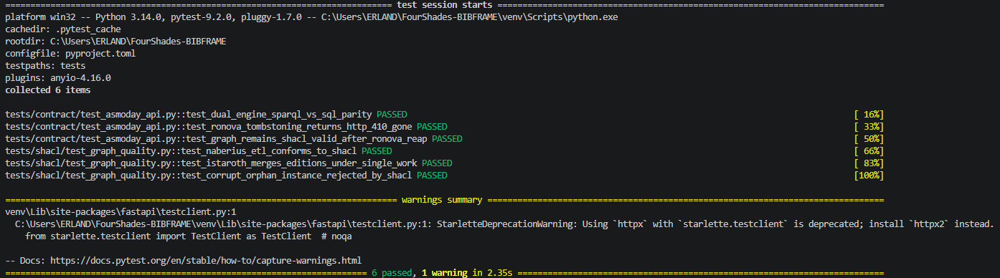
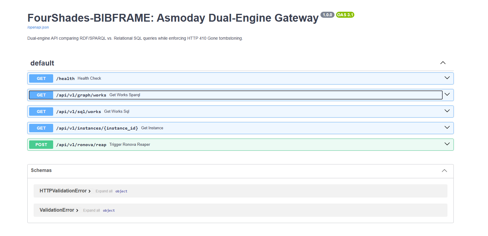
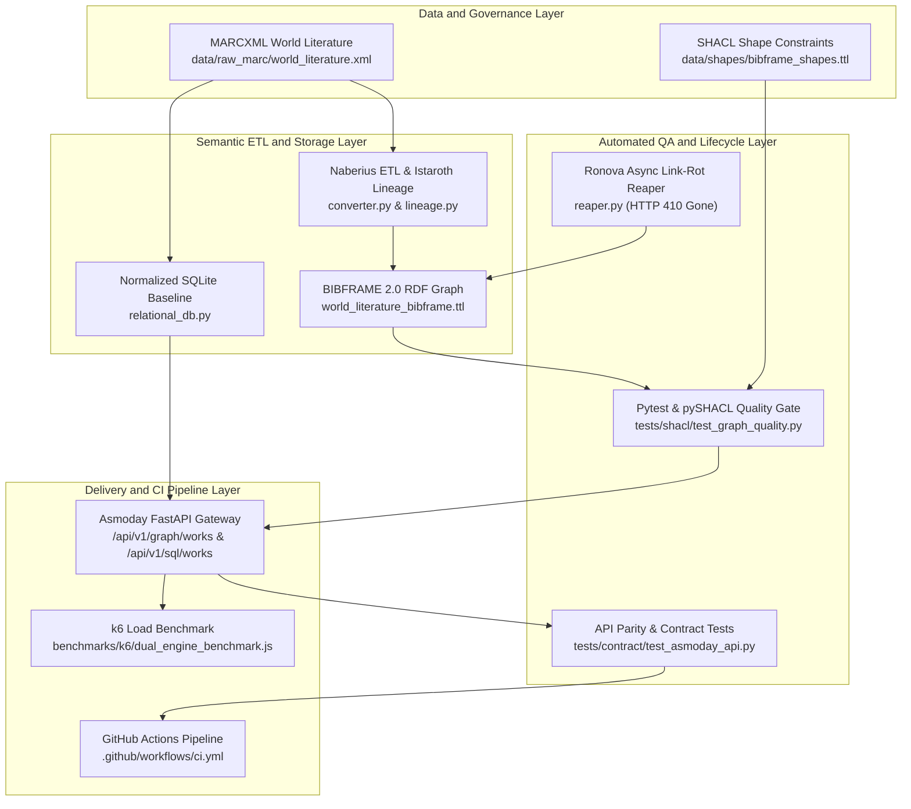

# 🏛️ FourShades-BIBFRAME - Semantic Bibliographic ETL & Dual-Engine QA Suite

An automated semantic data engineering, SHACL quality gate, and dual-engine API benchmarking suite designed to modernize legacy **MARC21** library catalogs into **BIBFRAME 2.0 RDF** knowledge graphs.

  

---

## 📌 1. Executive Summary

This automated data-engineering and Quality Assurance (QA) project is built to validate semantic catalog integrity and API performance across three primary core layers:

1. **Semantic ETL & Lineage Layer (`Naberius` & `Istaroth`):** Transforms legacy **MARC21 (MARCXML)** records into interconnected **BIBFRAME 2.0** entities (`bf:Work`, `bf:Instance`, `bf:Item`, `bf:Agent`, and `bf:ClassificationDdc`), deduplicating multilingual editions under canonical FRBR/LRM works with W3C `PROV-O` audit trails.
2. **Ontological Quality Gate Layer (`SHACL`):** Enforces strict **W3C SHACL (Shapes Constraint Language)** validation rules via `pyshacl` and `pytest` to block orphaned instances or malformed ISO 639-2 language codes before deployment.
3. **Dual-Engine API & Lifecycle Layer (`Asmoday` & `Ronova`):** Exposes identical bibliographic datasets across **SPARQL 1.1** and **Relational SQLite** endpoints in FastAPI for shadow parity testing, `k6` load benchmarking, and automated `HTTP 410 Gone` tombstoning of decayed external URIs.

All test scenarios utilize **Data-Driven & Schema-Driven Testing** architecture, isolating world literature MARCXML datasets (`world_literature.xml`) and ontological shape rules (`bibframe_shapes.ttl`) from the execution scripts.

---

## 💡 2. Problem Statement & Real-World Impact

In real-world library operations, migrating institutional Online Public Access Catalog (OPAC) systems from legacy MARC21 records to Linked Open Data (BIBFRAME 2.0) presents significant engineering challenges:

- **Legacy Flat-Record Silos & Entity Fragmentation:** Traditional MARC21 stores bibliographic descriptions as flat text strings rather than linked entities, causing original works and their international translations to exist as disconnected records across catalogs.
- **Schema Drift & Corrupted Graph Ingestion:** Without automated ontological validation, malformed RDF triples (such as orphaned `bf:Instance` nodes lacking a parent `bf:Work` or invalid ISO language codes) silently corrupt semantic search endpoints.
- **Silent Link-Rot & Unverified Migration Parity:** External digital resource URIs (`856$u`) decay over time without lifecycle auditing, while migrating queries from relational SQL joins to RDF graph stores risks data discrepancies and latency regressions.

### How FourShades-BIBFRAME Solves This:
**FourShades-BIBFRAME** serves as an automated governance pipeline between legacy MARC21 ingestion and live linked-data discovery:
- **Automated Ontological Quality Gate:** Replaces fragile manual RDF inspection by validating every generated knowledge graph against strict SHACL shape constraints in CI/CD.
- **Cross-Paradigm Shadow Parity:** Guarantees 100% data consistency between **SPARQL** graph queries and **SQL** relational joins while measuring `p95`/`p99` latency under concurrent `k6` load.
- **Self-Auditing Link Lifecycle:** Proactively probes external digital locators and transitions dead links into audited `HTTP 410 Gone` tombstones without breaking existing graph relationships.

---

## 🛠️ 3. Key Features

- **Naberius Semantic ETL Engine (`src/naberius_etl`):** Parses MARCXML records with `pymarc` and constructs normalized BIBFRAME 2.0 RDF triples serialized in Turtle (`.ttl`) format.
- **Istaroth FRBR & PROV-O Lineage (`src/istaroth_lineage`):** Computes deterministic SHA-256 `bf:Work` URIs from uniform titles (`240$a`) and creators (`100$a`) to merge multilingual editions while attaching W3C `PROV-O` timestamps.
- **SHACL Graph Quality Gate (`data/shapes/bibframe_shapes.ttl`):** Automated `pytest` + `pyshacl` validation suite including negative fuzzing tests that reject orphaned or corrupted bibliographic nodes.
- **Asmoday Dual-Engine Gateway (`src/asmoday_gateway`):** FastAPI service exposing parallel `/api/v1/graph/works` (SPARQL 1.1) and `/api/v1/sql/works` (SQLite `JOIN`) endpoints with interactive OpenAPI/Swagger documentation.
- **Ronova Asynchronous Link-Rot Reaper (`src/ronova_reaper`):** Non-blocking `httpx` auditor that detects dead `bf:electronicLocator` URLs, stamps `prov:invalidatedAtTime`, and enforces RFC 9110 **HTTP 410 Gone** responses.
- **Concurrent Load Benchmarking & CI/CD:** Integrated `k6` performance benchmark (`dual_engine_benchmark.js`) and GitHub Actions workflow (`.github/workflows/ci.yml`) running automated validation on every `push` and `pull_request`.

---

## ⚙️ 4. Installation & Usage Guide

### Prerequisites
- **Python:** 3.11 or higher
- **Git:** Installed and configured
- **k6** *(Optional, for running concurrent HTTP load benchmarks)*

### Step 1: Clone the Repository
`git clone https://github.com/erlandfauzan/FourShades-BIBFRAME.git`
`cd FourShades-BIBFRAME`

### Step 2: Set Up Virtual Environment (Recommended)
First, create the virtual environment:
`python -m venv venv`

Next, activate it based on your operating system:
- **Windows (PowerShell):** `.\venv\Scripts\Activate.ps1`
- **macOS / Linux:** `source venv/bin/activate`

### Step 3: Install Dependencies
`python -m pip install --upgrade pip`
`python -m pip install -r requirements.txt`

### Step 4: Execute ETL Pipeline & Automated Test Suite
Option A: Generate BIBFRAME 2.0 Knowledge Graph (`Turtle .ttl`)
`python -m src.naberius_etl.converter`

Option B: Run Automated SHACL Quality Gate & API Contract Tests
`pytest -v`

### Step 5: Launch Asmoday Dual-Engine API & Load Benchmark
Start the FastAPI gateway (interactive Swagger UI available at `http://127.0.0.1:8000/docs`):
`uvicorn src.asmoday_gateway.app:app --reload`

In a second terminal, execute the `k6` SPARQL vs. SQLite latency benchmark:
`k6 run benchmarks/k6/dual_engine_benchmark.js`

---

## 🌌 5. Origin & Naming Lore

In the cosmological lore of *Genshin Impact*, Celestia governs the foundational laws of Teyvat through the **Four Shades**, primordial entities presiding over **Life** (*Naberius*), **Time** (*Istaroth*), **Space** (*Asmoday*), and **Death** (*Ronova*), maintaining strict structural order across the world's records.

**FourShades-BIBFRAME** draws inspiration from this governance motif into concrete library data engineering and QA architecture. Each Shade encapsulates an isolated microservice responsibility: **Naberius** breathes semantic life into flat MARC21 records; **Istaroth** tracks chronological editions and provenance across time; **Asmoday** bridges relational and graph query spaces; and **Ronova** reaps decayed external URIs into audited `HTTP 410 Gone` tombstones.

---

## 📊 6. Test Execution Evidence

### 1. Terminal Execution Log (`Pytest` + `pySHACL` + Contract Suite)

### 2. Interactive Asmoday Dual-Engine Swagger UI

---

## 📁 7. Repository Structure

- `.github/workflows/ci.yml` - GitHub Actions CI/CD Pipeline & RDF Artifact Uploader
- `assets/` - Terminal Execution & Swagger UI Documentation Screenshots
- `benchmarks/k6/dual_engine_benchmark.js` - k6 Concurrent Load Test Script (SPARQL vs. SQLite)
- `data/raw_marc/world_literature.xml` - Authentic MARCXML Dataset (Japanese, German & American Literature)
- `data/shapes/bibframe_shapes.ttl` - W3C SHACL Ontological Validation Shapes
- `data/output/world_literature_bibframe.ttl` - Generated BIBFRAME 2.0 RDF Knowledge Graph
- `docs/index.html` - Interactive GitHub Pages Architecture & QA Simulator
- `src/naberius_etl/converter.py` - MARCXML-to-BIBFRAME 2.0 Semantic ETL Engine
- `src/istaroth_lineage/lineage.py` - Deterministic FRBR `bf:Work` Deduplication & `PROV-O` Tracker
- `src/asmoday_gateway/app.py` - FastAPI Dual-Engine Gateway & HTTP 410 Tombstone Handler
- `src/asmoday_gateway/relational_db.py` - Normalized SQLite Relational Schema & SQL `JOIN` Baseline
- `src/ronova_reaper/reaper.py` - Asynchronous External URI Link-Rot Auditor
- `tests/shacl/test_graph_quality.py` - Pytest SHACL Validation, Lineage & Negative Fuzzing Suite
- `tests/contract/test_asmoday_api.py` - SPARQL vs. SQL Parity & HTTP 410 Contract Test Suite
- `.gitignore` - Git Exclusion File
- `pyproject.toml` - Centralized Pytest Path & Discovery Configuration
- `README.md` - Project Documentation
- `requirements.txt` - Project Dependencies

---

## ⏳ 8. Architecture & Test Flow Diagram

The diagram below illustrates the end-to-end execution workflow of the suite from MARCXML ingestion to dual-engine benchmarking and CI/CD enforcement:

